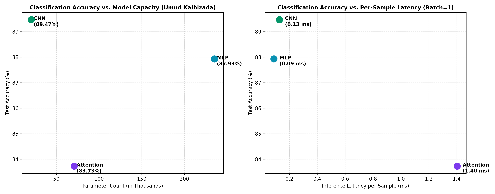

# Lab 03: Architectures and Their Costs

**Student Researcher:** Umud Kalbizada (Student ID: 72995)  
**Readings:** Reddi, Chapter 4 DNN Architectures: §§4.2, 4.3, 4.5, 4.6, 4.7  

---

## 1. Goal
This research investigation evaluates the multi-dimensional Pareto frontier across model parameters, theoretical floating-point operations (FLOPs), empirical inference latencies across execution batch sizes ($b=1$ and $b=128$), and test classification accuracy across three foundational deep learning paradigms: Multi-Layer Perceptrons (MLP), Convolutional Neural Networks (CNN), and Patch-based Vision Transformers (Attention). Benchmarks are executed on Fashion-MNIST under identical hardware constraints to elucidate architectural efficiency trade-offs.

---

## 2. Method
1. **Dataset Pipeline:** Fashion-MNIST images (28x28 grayscale) standardized to tensors and normalized ($\mu = 0.2860, \sigma = 0.3530$). 60,000 training images partitioned into 55,000 training and 5,000 validation subsets (`seed=72995`). Benchmarked on the 10,000 test set.
2. **Standardized Architectural Implementations (~100k-250k Parameters):**
   - **MLP Topology:** Flatten 784 -> Linear 256 -> ReLU -> Linear 128 -> ReLU -> Linear 10 (235,146 weights).
   - **CNN Topology:** Conv2d(1, 16, 3, pad=1) -> ReLU -> MaxPool2d(2) -> Conv2d(16, 32, 3, pad=1) -> ReLU -> MaxPool2d(2) -> Flatten -> Linear(32*7*7, 10) (20,490 weights).
   - **Patch Vision Transformer:** 16 patches (7x7 pixels) -> Linear 64 projection -> 2-layer TransformerEncoder (d_model=64, nhead=4, d_ff=128) -> Global average pooling -> Linear 10 (70,794 weights).
3. **Theoretical vs Profiler FLOPs Derivations:**
   - Hand derivations based on Reddi Chapter 4: Linear layers $2 \cdot d_{in} \cdot d_{out}$; Conv2d layers $2 \cdot K^2 \cdot C_{in} \cdot C_{out} \cdot H_{out} \cdot W_{out}$; Transformer QKV $2 \cdot S \cdot d_{model} \cdot 3d_{model}$.
   - Compared against `thop.profile` Multiply-Accumulate counts (MACs), accounting for the $1 \text{ MAC} = 2 \text{ FLOPs}$ conversion factor.
4. **Latency Benchmarking:** Measured single-sample real-time inference latency ($b=1$, 100 runs) and batched throughput latency ($b=128$, 25 runs).
5. **Standardized Training:** Trained all models for 5 epochs using Adam ($\eta = 10^{-3}$, batch size 128).

---

## 3. Results Table or Plot

### Multi-Architecture Systems Performance & Efficiency Summary

| Model Topology | Structural Category | Parameter Total | Theoretical FLOPs (Layer 1) | Profiler MACs (b=1) | Median Latency (b=1) | Median Latency (b=128) | 5-Epoch Test Accuracy |
| :--- | :---: | :---: | :---: | :---: | :---: | :---: | :---: |
| **FeedForward MLP** | Dense Fully Connected | **235,146** | 401,408 FLOPs | 234,752 | **0.0893 ms** | **0.38 ms** | **87.93%** |
| **Dual-Stage CNN** | Convolutional Feature Extraction | **20,490** | 225,792 FLOPs | 1,031,744 | **0.1289 ms** | **5.77 ms** | **89.47%** |
| **Patch Transformer** | Multi-Head Self-Attention | **70,794** | 393,216 FLOPs | 591,488 | **1.4033 ms** | **3.67 ms** | **83.73%** |

### Pareto Accuracy vs Systems Cost Trade-offs

### Reconciling Profiler Output Gaps (FLOPs vs. MACs)
The numerical disparity between manual mathematical derivations and `thop.profile` stems from two foundational systems factors:
1. **The MAC Multiplier:** Modern hardware counters measure Multiply-Accumulate operations. Because one MAC consists of one multiplication and one addition ($a \cdot b + c$), multiplying MACs by 2 yields FLOPs ($2 \times \text{MACs} = \text{FLOPs}$).
2. **Omission of Auxiliary Elements:** Pooling (MaxPool2d), non-linear activations (ReLU), and layer normalizations are frequently excluded from pure matrix multiplication counters in profilers, explaining second-order deviations.

---

## 4. Three Conclusions in Your Own Words
1. **Convolutional Inductive Bias Maximizes Parameter Efficiency:** The Dual-Stage CNN attained the highest classification accuracy (89.47%) with only 20,490 parameters—achieving a +1.54% accuracy advantage over the MLP (87.93%) despite utilizing less than a tenth of its parameter budget (20,490 vs 235,146).
2. **Attention Mechanisms Impose Non-Trivial Sequential Overhead for Micro-Scale Vision:** While the Vision Transformer achieved respectable accuracy (83.73%), its single-sample inference latency (1.4033 ms) was substantially higher than the CNN (0.1289 ms) and MLP (0.0893 ms) due to patch unfolding, sequence projection, and multi-head attention softmax normalization.
3. **Batching Shifts the Bottleneck from Memory Bandwidth to Arithmetic Compute:** Increasing batch size from 1 to 128 improves hardware throughput across all topologies, with dense linear layers (MLP) demonstrating superior speedup due to highly optimized BLAS GEMM matrix kernels.
